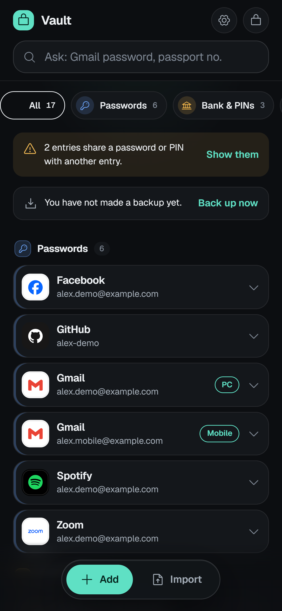
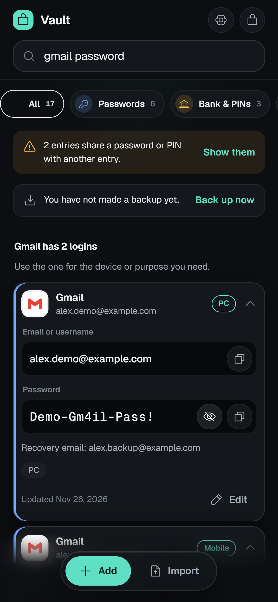
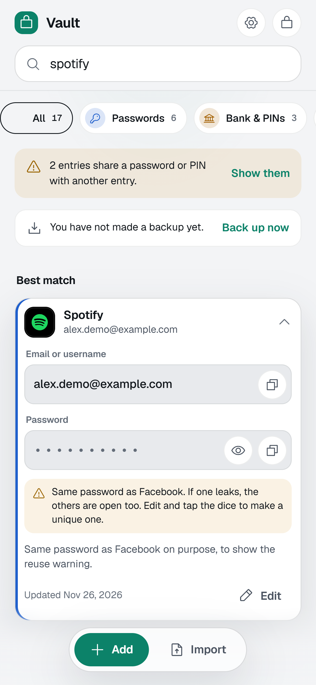
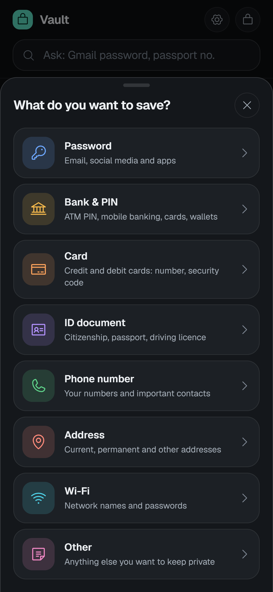
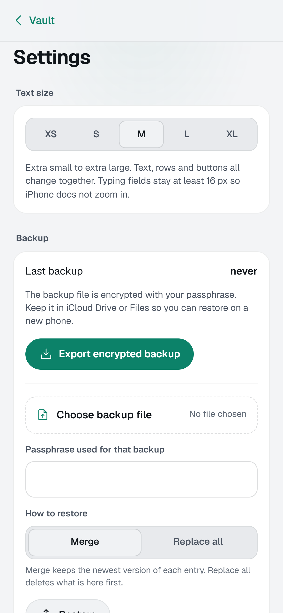
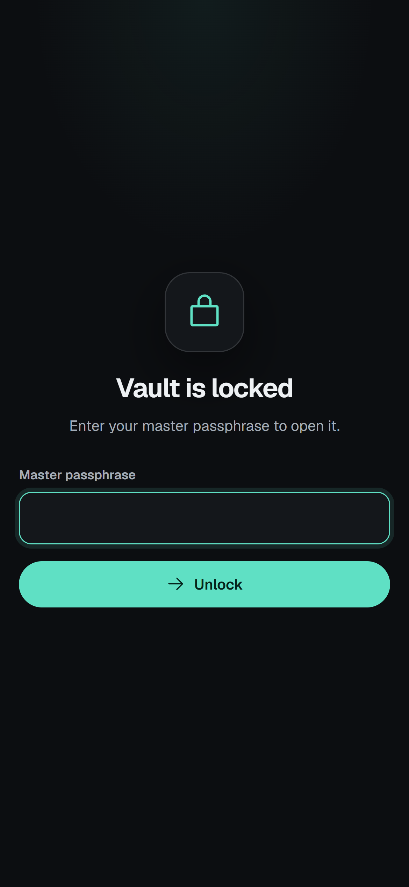

# Vault

**A private password, PIN and ID vault for iPhone, built as an installable web app.**
Everything is encrypted on the phone. There is no server, no account and no cloud copy: the
hosting only serves the app's code.

     

<p align="center">
  
  
  
</p>
<p align="center">
  
  
  
</p>

> All screenshots use the fake data in [`demo/`](demo). No real accounts appear anywhere in this repository.

## Features

- **Ask in plain words**: "gmail password", "4 digit pin of my bank", "passport number". On-device search understands synonyms, typos and PIN or password hints, and shows every match when a service has several logins (tags such as *PC* and *Mobile*).
- **Categories with colours and logos**: passwords, bank & PINs, cards, ID documents, phone numbers, addresses, Wi-Fi and notes. Official brand logos come from [Simple Icons](https://simpleicons.org), bundled into the app.
- **Password history**: changing a value keeps the old one with its date.
- **Reuse warning**: flags entries that share a password or PIN and links you to a strong generator.
- **Encrypted backup and restore**: export a file to iCloud Drive or Files; merge it or replace on another phone.
- **Face ID unlock (optional)**: via a passkey and the WebAuthn PRF extension (iOS 18+).
- **Screenshot import (optional)**: Gemini reads a screenshot of a login or card, and you check every field before anything is saved.
- **iPhone-friendly**: works offline, auto-locks, no zoom on input, adjustable text size (XS–XL), dark and light themes.

## Try it with the demo vault

1. Run the app (see below) and open it.
2. Choose **I have a backup file** and pick [`demo/demo-backup.json`](demo/demo-backup.json).
3. Backup passphrase: `demo-vault-passphrase`. Choose any new master passphrase.

The demo holds 17 made-up entries ([`demo/demo-entries.json`](demo/demo-entries.json)) with `example.com` accounts and the public Visa test card number.

## Security model

| What | How |
| --- | --- |
| Vault at rest | One AES-256-GCM blob in IndexedDB (names, accounts, secrets, notes, history, settings). A fresh random 96-bit IV for every save. |
| Key | Argon2id (64 MiB, 3 passes, 16-byte salt) from the master passphrase, imported into Web Crypto as a non-extractable key. Older PBKDF2-SHA256 (600k) vaults still open and are upgraded on the next unlock. |
| Master passphrase | At least 12 characters mixing letters with numbers or symbols, or a 20+ character sentence. There is no reset and no recovery. |
| Backups | Same encryption. Key settings are validated before use (refuses weakened or "freeze" files). Restoring on a new phone asks for a new master passphrase. |
| Session | Locks after 1–10 minutes idle and as soon as the app is hidden. Revealed values hide after 20 s. Copied secrets are cleared after 30 s, or on the next tap after that (iOS only allows clipboard writes during a tap). |
| Face ID | A passkey's PRF secret wraps the passphrase on the device. iOS also accepts the device passcode, so the master passphrase is required again every 7 days. |
| Network | Strict Content-Security-Policy: the page can talk only to itself and, if you turn Gemini on, `generativelanguage.googleapis.com`. No analytics, no third-party scripts or fonts. HSTS, `frame-ancestors 'none'`, `nosniff`, `no-referrer`. |
| Gemini (off by default) | Search sends only names, tags and masked accounts. Screenshot import sends the picture you choose. A free API key's data may be used by Google, so a paid key is recommended. |
| XSS | The UI is built with `createElement` and `textContent`, never `innerHTML` or `eval`. |

**Not protected against:** someone who knows your passphrase (or your iPhone passcode while Face ID is on), malware on the phone, or whoever controls the hosting account. Protect that account with two-factor sign-in.

### Security review

The code was reviewed manually and with Semgrep, Gitleaks, OSV-Scanner, npm audit, ESLint security plugins and an OWASP ZAP baseline scan. Findings that were fixed, each with tests:

- Restoring a backup no longer keeps the backup's passphrase; the vault is re-keyed with a new one.
- Backup files with unsafe key settings are refused.
- Argon2id replaced PBKDF2, with automatic upgrade of existing vaults.
- Stronger master passphrase rules, a password reuse warning, reliable clipboard clearing on iOS, a weekly passphrase check for Face ID and a shorter auto-lock pause while picking files.

This is a personal project and has **not** had an independent third-party audit.

## Run it

```bash
npm install
npm run dev        # development server
npm test           # 28 tests: crypto, vault, backups, Face ID, passphrase rules, demo file
npm run build      # type-check and production build into dist/
npm run preview    # serve the build with the production security headers
```

### Deploy

Any static host works. With Vercel (`vercel.json` sets the security headers):

```bash
npx vercel --prod
```

Then open the link in Safari on iPhone, tap **Share → Add to Home Screen**, and always open it from the icon (iOS keeps Home Screen app storage). Make an encrypted backup after big changes.

### Optional local brand logos

`src/icons.ts` covers well-known brands. To add logos for local services (for example your banks), create a git-ignored `src/brands.local.ts` that exports `LOCAL_BRANDS` and put the icon files in `src/assets/brands/`. The app builds and runs without them.

## Project structure

```
src/
  crypto.ts        AES-256-GCM, Argon2id / PBKDF2 key derivation (Web Crypto + hash-wasm)
  vault.ts         vault state, entries, history, reuse check, backup format and validation
  db.ts            tiny IndexedDB key-value store (atomic writes)
  faceid.ts        passkey + PRF wrapping of the passphrase, 7-day re-check
  search.ts        on-device natural-language search
  strength.ts      master passphrase rules
  gemini.ts        optional Gemini search and screenshot extraction
  extract-prompt.json  instructions sent with a screenshot
  categories.ts    categories, labels and icons
  icons.ts         Phosphor icons and Simple Icons brand logos
  main.ts          UI (no framework)
sw/sw.js           service worker (offline, own files only)
scripts/           icon generator, encrypted restore-file maker
tests/             node:test suites
demo/              fake demo vault
```

## Credits

[Phosphor Icons](https://phosphoricons.com) (MIT), [Simple Icons](https://simpleicons.org) (CC0; brand names and logos are trademarks of their owners), [Geist](https://vercel.com/font) (OFL), [hash-wasm](https://github.com/Daninet/hash-wasm) (MIT).

## License

[MIT](LICENSE)
